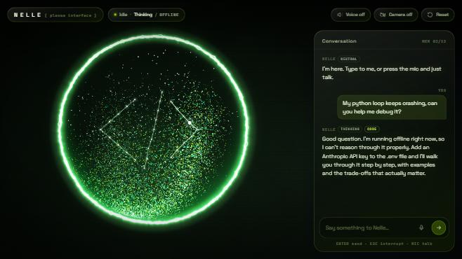
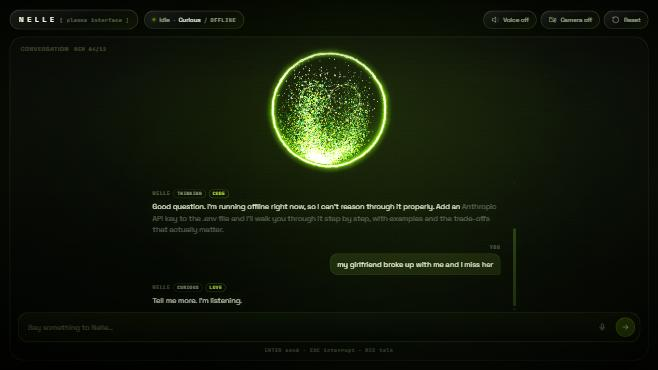
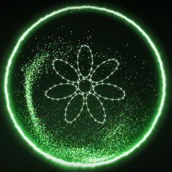
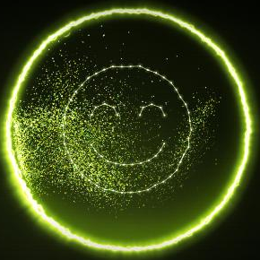
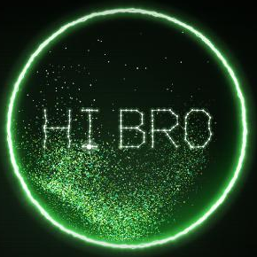

# Nelle AI: an emotionally aware plasma ball

[](https://github.com/rohanjaswara88-art/nelle-AI/actions/workflows/ci.yml)

Nelle is an AI you talk to in the browser. She lives inside a crystal ball of crackling lime plasma and drifting dust, on a black, lightly fogged stage. She reads the whole conversation, decides how she feels about it, and shows that feeling: in the ball's colour, crackle and sparks, in the fog around it and in the tone of her voice. Inside the ball, points of light join up into a picture of what you are talking about: `</>` for code, a heart for love, Saturn for space. When you send a message, the ball swirls as it takes it in. Ask by voice and she answers out loud, with the rim swelling and sparking in time with her words. Type, and she answers in text while the ball stirs gently in the background.

> Built by [Rohan Jaswara](https://rohanjaswara88-art.github.io/portfolio/), a BCA (AI & ML) student.



| Idle | Searching | Love, concerned |
|---|---|---|
|  |  |  |

The whole screen is one chat box: the sphere lives at its top and reacts from there, the messages scroll in a centred column underneath, and the input runs the full width along the bottom. Once the conversation starts, the sphere steps back a little to give the messages room. On a phone it is the same box, just tighter.

## What she does

- **Feels the conversation.** Each reply comes back as structured JSON: `{emotion, intensity, response, voiceStyle}`, from 14 emotions (happy, excited, sad, frustrated, confused, curious, surprised, disappointed, nervous, casual, playful, thinking, concerned, neutral). Claude reads the last 12 messages and her current mood, not just keywords.
- **Doesn't flicker between moods.** A smoother keeps her mood steady: a weak, different emotion is ignored and the current one fades, while a clear new emotion takes over. A repeated emotion blends its intensity instead of jumping.
- **Shows it in the ball.** Each emotion has its own shade of the lime palette and its own energy: excited is electric yellow-lime with fast dust and lots of sparks, sad and disappointed sink to a dim teal with slow dust settling low, frustrated crackles amber, thinking turns mint with arcs chasing round the rim. Changes blend smoothly over about a second.
- **Draws the topic.** A constellation of 72 points lives inside the ball. At rest it is a slowly turning network globe. When she answers, the server works out what the exchange is about (`topics.py`, 17 topics) and the points fly into a shape for it, with the lines drawing themselves in: `</>` code, a neural net for AI, Σ maths, an atom for science, Saturn for space, notes for music, a heart for love, a heartbeat for health, a rising chart for money, a storm cloud for weather, a clock for time and history, a leaf for nature, a paper plane for travel, a globe for the web, an open book for writing, a smile for fun and a cup for food. The shape sways in 3D, sparks of thought run along its lines (faster while she speaks), and it all scales with the ball, so it fits any screen.
- **Shows her thinking.** While she finds an answer, the points let go of their shape and drift through the ball, linking and unlinking with their neighbours as if browsing, while the dust turns into a slow vortex. If the answer takes longer, she starts *searching*: everything moves faster, sparks race along the links and sonar pings ripple out into the fog. When the answer is found, a ripple bursts out of the ball and the points assemble into the topic's shape.
- **Reacts to you.** Sending a message swirls the dust up from below. Listening sends slow rings out into the fog. Hovering or clicking the ball stirs it too.
- **Speaks with one voice.** She uses a single neural voice (edge-tts `en-US-AvaNeural`) with small rate and pitch changes per emotion. The audio's loudness swells the rim and gently pulses the ball, and emphasised words fire sparks along the rim.
- **Can be interrupted.** Press Esc or the stop button, or send a new message. The audio and the ball's speaking motion stop cleanly, and the unspoken rest of the reply is dimmed.
- **Gets sums right.** Plain arithmetic ("what is 23 × 47", "15% of 200") is worked out exactly on the server by `calc.py`, not guessed by the AI. It parses with `ast` and allows only numbers, + − × ÷ %, powers and square roots, so nothing you type is ever executed.
- **Still does the old commands.** "open YouTube", "search Google for …", "what's the time" work from the chat. A sentence like "I had a hard time today" goes to the AI, not the clock.
- **Sees your hand (optional).** Turn on **Camera** and Nelle watches one hand through your webcam. See [Hand gestures](#hand-gestures).

## Hand gestures

| Two fingers | Five fingers | Thumbs up |
|---|---|---|
|  |  |  |

Press the **Camera** pill in the top bar (it stays off until you turn it on, and the choice is remembered). A small mirrored preview appears in the bottom-left corner with your hand's 21 tracking points drawn in lime; click it to hide the video and keep just the points.

| Show | Nelle |
|---|---|
| ✌️ Two fingers (index and middle up, ring and pinky down) | The constellation blooms into a flower, petal after petal, while arcs circle the rim. |
| 🖐️ All five fingers, spread | A smiling face with happy ^ ^ eyes; her mood turns happy for a moment and the dust gets one playful kick. |
| 👍 Thumbs up | "HI BRO" is spelled out with glowing particles streaming up from the dust, then they scatter back. |
| 🤟 Three fingers up (index, middle, ring), then tilt just the fingers, or move the hand, up or down | Scrolls the conversation like a mouse: the fingertips drive it, so you can keep your hand still and just tip the three fingers forward (scrolls down) or back (scrolls up). Small movements make small, precise scrolls, quick flicks go further, it stops the moment your fingers stop, and a flick glides on briefly when you let go. A "3-finger scroll" cue appears in the chat box and the dust drifts with you. |
| ☝️ Point with your index finger and move it | The sphere follows your fingertip: a glowing tip with a comet trail appears inside the ball, the plasma dust is dragged hard the way you move and leans toward it, nearby constellation points are pulled in on threads of light, quick moves throw the dust and spark the rim, and a fast wave sends ripples across. Lower or open your finger and it lets go. |

Following only happens while you point (index up, the other three fingers folded; the thumb can do anything), so ordinary hand movement doesn't stir anything. Hold a pose still for about a tenth of a second. Each gesture fires once per showing: lower your hand (or change pose), then show it again; the same gesture can't repeat within 2.5 seconds. Gestures are ignored while one is already playing, and for a moment after you type, so hands on the keyboard don't set anything off. Each shape lasts about 2.5 seconds, then the ball goes back to the topic shape (or to thinking). With *reduce motion* turned on in your system settings, the effects are shorter and calmer.

**Privacy.** Hand tracking runs entirely in your browser with [MediaPipe Hand Landmarker](https://ai.google.dev/edge/mediapipe/solutions/vision/hand_landmarker). Camera frames go from the video element straight into the on-device model; they are never uploaded, never sent to Nelle's server and never saved. The only network requests are downloading the MediaPipe library (jsDelivr) and the hand model file (Google's model storage) when you first turn the camera on. Turning the camera off stops it immediately.

Needs Chrome, Edge or another browser with camera access, over `localhost` or HTTPS.

**Speed and reliability.** Tracking runs on the GPU where possible, on every new camera frame the moment it arrives (and the camera is asked for up to 60 frames a second), so the sphere reacts with very little lag; on a slow machine it leaves a frame between detections so the animation stays smooth. Finger states are read from MediaPipe's 3D hand model, so a hand tilted toward the camera still reads correctly, and each finger is "sticky": it only changes between open and folded when it clearly does, so poses don't flicker. A gesture needs about four camera frames, and a single unclear frame in the middle doesn't spoil it.

**Debugging.** Open `http://127.0.0.1:8000/?debug=gestures` for a panel with each finger's state (extended, folded or unsure), the detected pose, whether it is following or scrolling, whether 3D landmarks are in use, detections per second and the time each one takes. **Copy landmarks** copies the current hand as a JSON test fixture.

**Adding a gesture.** Write a pose rule in `web/poses.js`, add `{ name, detect }` to `GESTURES` in `web/gestures.js`, and map the name to an animation in `GESTURE_ACTIONS` in `web/app.js`. Shapes for the constellation go in `GESTURE_SHAPES` in `web/constellation.js`; new words just need their letters in the stroke font, `web/strokefont.js`.

## Run it

Needs Python 3.10+ and an internet connection for the voice.

```bash
pip install -r requirements.txt
python nelle2/server.py
```

Open http://127.0.0.1:8000. Voice input (the mic button) needs Chrome or Edge.

### Add the AI (optional)

Without a key, Nelle runs in **offline mode**: simple built-in replies, so the app and tests work anywhere. To use Claude:

1. Copy `.env.example` to `.env` (it is git-ignored, so it is never committed).
2. Put your Anthropic API key after `ANTHROPIC_API_KEY=`.
3. Restart the server. The status pill changes from `OFFLINE` to `CLAUDE`.

The default model is `claude-opus-5-5`. You can change it with `NELLE_MODEL` in `.env`. If a Claude call fails, Nelle answers offline instead of breaking.

## How it works

```
browser                                       Python (FastAPI)
───────                                       ────────────────
app.js            emotion controller ── /api/chat ──► brain.py    memory + Claude (or offline)
stage.js          fog, mood and motion                  ├─► emotion.py  parse, validate, smooth
crystal.js        the plasma ball (WebGL)               └─► topics.py   what the exchange is about
constellation.js  topic shapes in the ball   ◄── /api/tts ── voice.py    edge-tts audio + word timings
voice.js          audio playback + speech input
gestures.js       camera + MediaPipe hand tracking (in the browser only)
poses.js          pose rules, debouncing and hand-movement smoothing
```

1. **Listen.** You type, or speak (the browser's speech recognition).
2. **Think.** `brain.py` sends commands to `match_command` and everything else to Claude with the recent conversation. `emotion.py` validates the JSON and repairs or replaces anything malformed, then smooths the mood.
3. **Feel.** `app.js` passes the emotion to the stage (ball colour, crackle, sparks, dust speed and fog) and the chat, and the topic to the constellation.
4. **Speak.** For voice replies, `/api/tts` returns the MP3 and per-word timings. The words appear in time with the voice, the audio loudness swells the rim, and emphasised words spark.

The scene is one `requestAnimationFrame` loop that pauses when the tab is hidden. It runs at about 100 fps on a laptop.

The plasma ball is adapted from [CrystalizedBall by React Bits](https://reactbits.dev/animations/crystalized-ball) (MIT + Commons Clause, © David Haz), ported from React to plain JavaScript. It uses [ogl](https://github.com/oframe/ogl) from a CDN and needs a browser with WebGL2; without it, a soft glowing orb is shown instead.

## Tests

```bash
pip install -r requirements-dev.txt
python -m pytest
```

Tests cover arithmetic (including unsafe input), emotion parsing and validation (bad JSON, unknown emotions, out-of-range intensity, missing fields), mood smoothing, memory, offline fallback, telling commands apart from ordinary sentences, the API endpoints, voice delivery per emotion, and every original command.

The hand-pose rules have their own tests, run with Node's built-in test runner (Node 22 or newer):

```bash
node --test "tests/js/*.test.mjs"
```

They check each pose, pointing and three-finger scrolling against 102 landmark fixtures: both hands, tilted, near and far, with positives for every gesture and near misses that must not fire (three fingers, a half-bent finger, fingers held together, thumbs down, a sideways thumb, and more). They also cover the debouncing (four frames, one unclear frame tolerated, confidence, cooldown, release), the sticky finger states, reading from 3D landmarks, the movement filter's dead zone and wave detection, fingertip scrolling (a finger-only tilt scrolls, camera jitter and leaning in don't, small moves still count, flicks go further, the same near or far), the scroller's smoothing and glide, and the stroke font. The fixtures are generated with realistic hand proportions by `tests/js/make-fixtures.mjs`; hands recorded from a real camera can be added to `tests/js/fixtures/recorded.json` with the debug panel's **Copy landmarks** button.

GitHub Actions runs both suites on every push and pull request, with no API key needed.

## Project structure

```
nelle2/
  server.py    FastAPI app: UI, /api/chat, /api/tts, /api/reset
  brain.py     short-term memory, Claude call, offline fallback
  emotion.py   emotion JSON parsing, validation and smoothing
  calc.py      exact, safe arithmetic for maths questions
  topics.py    keyword topic detection for the constellation
  voice.py     edge-tts voice with per-emotion delivery and word timings
  commands.py  the original command matcher (open, search, time)
  nelle.py     the original terminal voice assistant (still works)
  web/         index.html, styles.css, app.js, stage.js, crystal.js, constellation.js, voice.js,
               gestures.js, poses.js, handscroll.js, strokefont.js, gesture-debug.js
tests/         pytest tests; tests/js has the Node tests for the hand-pose rules
docs/          screenshots
```

The original assistant still runs on its own with `python nelle2/nelle.py` (Windows, microphone, SAPI5 voice).

## Tech

Python · FastAPI · Claude API · edge-tts · WebGL2 (ogl) · Canvas 2D · Web Audio · Web Speech API · MediaPipe Hand Landmarker · pytest · node:test
