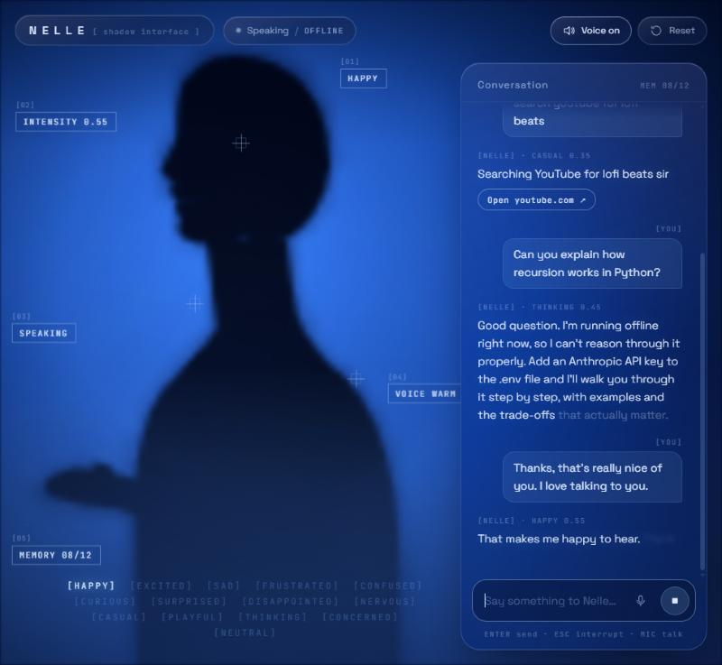
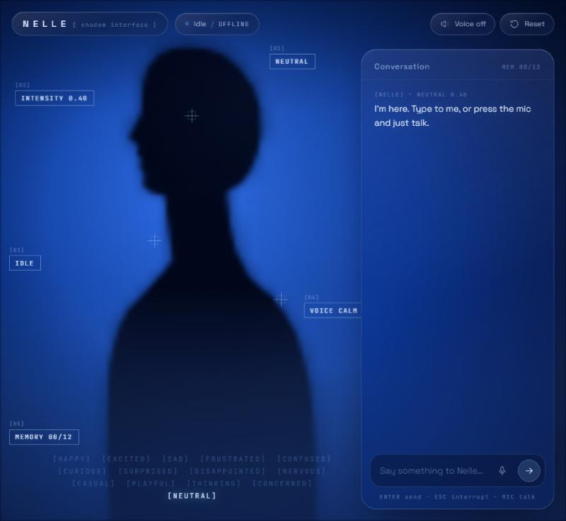
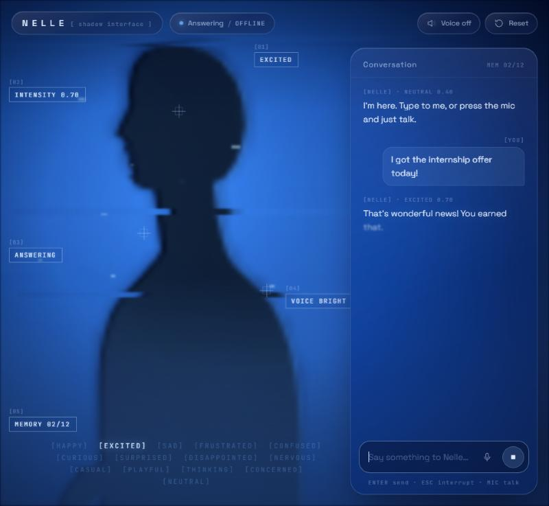
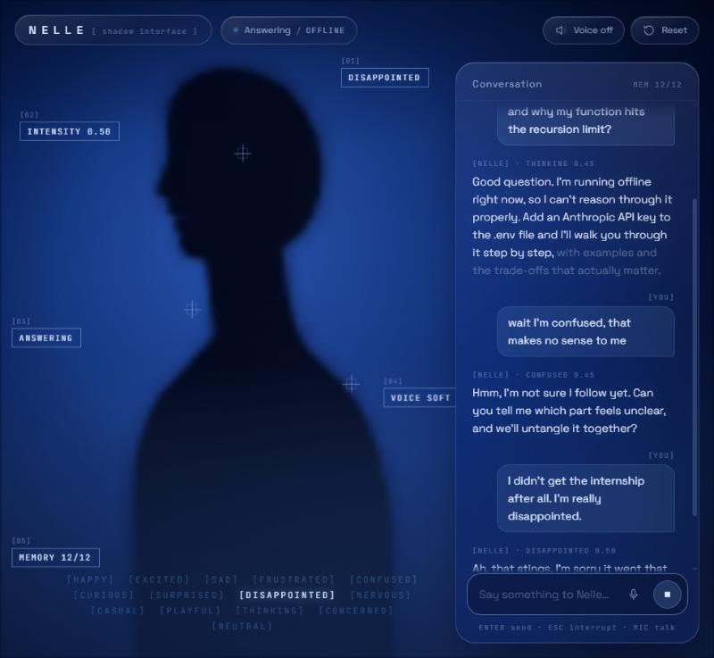

# Nelle AI: an emotionally aware shadow

[](https://github.com/rohanjaswara88-art/nelle-AI/actions/workflows/ci.yml)

Nelle is an AI you talk to in the browser. She appears as a soft shadow in blue fog. She reads the whole conversation, decides how she feels about it, and shows that feeling: in her posture and movement, in the colour of the fog, in the tone of her voice, and in the HUD around her. Ask by voice and she answers out loud, nodding and gesturing as she speaks. Type, and she answers in text while moving quietly in the background.

> Built by [Rohan Jaswara](https://rohanjaswara88-art.github.io/portfolio/), a BCA (AI & ML) student.



| Idle | Thinking | Excited | Disappointed |
|---|---|---|---|
|  |  |  |  |

## What she does

- **Feels the conversation.** Each reply comes back as structured JSON: `{emotion, intensity, response, voiceStyle}`, from 14 emotions (happy, excited, sad, frustrated, confused, curious, surprised, disappointed, nervous, casual, playful, thinking, concerned, neutral). Claude reads the last 12 messages and her current mood, not just keywords.
- **Doesn't flicker between moods.** A smoother keeps her mood steady: a weak, different emotion is ignored and the current one fades, while a clear new emotion takes over. A repeated emotion blends its intensity instead of jumping.
- **Moves like a person.** Breathing, slow gaze shifts and small sway run all the time. Moods change her posture: sad slumps and lowers the head, curious leans in, surprised pulls back. All motion goes through springs and easing, never instant switches.
- **Speaks with one voice.** She uses a single neural voice (edge-tts `en-US-AvaNeural`) with small rate and pitch changes per emotion. Her jaw follows the loudness of the audio, so the profile visibly speaks. Emphasised words trigger small nods and hand gestures, and her mouth returns to rest when she finishes.
- **Can be interrupted.** Press Esc or the stop button, or send a new message. The audio, jaw motion and gestures stop cleanly, and the unspoken rest of the reply is dimmed.
- **Still does the old commands.** "open YouTube", "search Google for …", "what's the time" work from the chat. A sentence like "I had a hard time today" goes to the AI, not the clock.

## Run it

Needs Python 3.10+ and an internet connection for the voice.

```bash
pip install -r requirements.txt
python nelle2/server.py
```

Open http://127.0.0.1:8000. Voice input (the mic button) needs Chrome or Edge.

### Add the AI (optional)

Without a key, Nelle runs in **offline mode**: simple built-in replies, so the app and tests work anywhere. To use Claude:

1. Copy `.env.example` to `.env` (it is git-ignored, so it is never committed).
2. Put your Anthropic API key after `ANTHROPIC_API_KEY=`.
3. Restart the server. The status pill changes from `OFFLINE` to `CLAUDE`.

The default model is `claude-opus-5-5`. You can change it with `NELLE_MODEL` in `.env`. If a Claude call fails, Nelle answers offline instead of breaking.

## How it works

```
browser                                   Python (FastAPI)
───────                                   ────────────────
app.js     emotion controller ── /api/chat ──► brain.py   memory + Claude (or offline)
stage.js   fog, shadow, motion, glitch           └─► emotion.py  parse, validate, smooth
figure.js  the silhouette's parts         ◄── /api/tts ── voice.py   edge-tts audio + word timings
hud.js     bracketed labels + lexicon
voice.js   audio playback + speech input
```

1. **Listen.** You type, or speak (the browser's speech recognition).
2. **Think.** `brain.py` sends commands to `match_command` and everything else to Claude with the recent conversation. `emotion.py` validates the JSON and repairs or replaces anything malformed, then smooths the mood.
3. **Feel.** `app.js` passes the emotion to the stage (posture, fog colour, glitch rate), the HUD and the chat.
4. **Speak.** For voice replies, `/api/tts` returns the MP3 and per-word timings. The words appear in time with the voice, and the audio loudness drives the jaw, nods and gestures.

The scene is one `requestAnimationFrame` loop that pauses when the tab is hidden. The silhouette is drawn small and scaled up, which blurs it cheaply, so it stays light on ordinary laptops.

## Tests

```bash
pip install -r requirements-dev.txt
python -m pytest
```

Tests cover emotion parsing and validation (bad JSON, unknown emotions, out-of-range intensity, missing fields), mood smoothing, memory, offline fallback, telling commands apart from ordinary sentences, the API endpoints, voice delivery per emotion, and every original command. GitHub Actions runs them on every push and pull request, with no API key needed.

## Project structure

```
nelle2/
  server.py    FastAPI app: UI, /api/chat, /api/tts, /api/reset
  brain.py     short-term memory, Claude call, offline fallback
  emotion.py   emotion JSON parsing, validation and smoothing
  voice.py     edge-tts voice with per-emotion delivery and word timings
  commands.py  the original command matcher (open, search, time)
  nelle.py     the original terminal voice assistant (still works)
  web/         index.html, styles.css, app.js, stage.js, figure.js, hud.js, voice.js
tests/         pytest tests
docs/          screenshots
```

The original assistant still runs on its own with `python nelle2/nelle.py` (Windows, microphone, SAPI5 voice).

## Tech

Python · FastAPI · Claude API · edge-tts · Canvas 2D · Web Audio · Web Speech API · pytest
