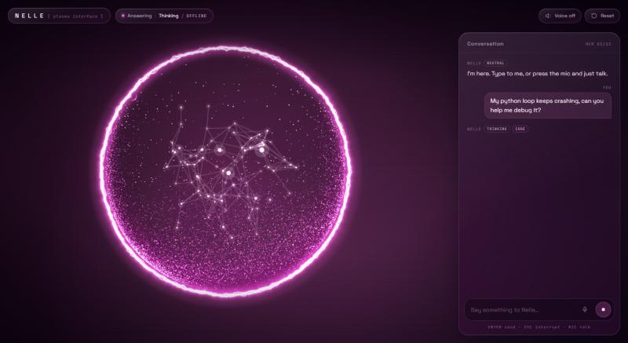
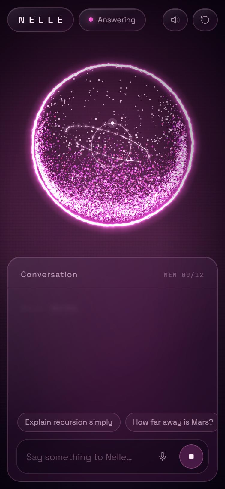

# Nelle AI: an emotionally aware plasma ball

[](https://github.com/rohanjaswara88-art/nelle-AI/actions/workflows/ci.yml)

Nelle is an AI you talk to in the browser. She lives inside a crystal ball of crackling pink plasma and drifting dust. She reads the whole conversation, decides how she feels about it, and shows that feeling: in the ball's colour, crackle and sparks, in the fog around it and in the tone of her voice. Inside the ball, points of light join up into a picture of what you are talking about: `</>` for code, a heart for love, Saturn for space. When you send a message, the ball swirls as it takes it in. Ask by voice and she answers out loud, with the rim swelling and sparking in time with her words. Type, and she answers in text while the ball stirs gently in the background.

> Built by [Rohan Jaswara](https://rohanjaswara88-art.github.io/portfolio/), a BCA (AI & ML) student.


| Idle | Searching | Love, concerned | Phone |
|---|---|---|---|
|  |  |  |  |

## What she does

- **Feels the conversation.** Each reply comes back as structured JSON: `{emotion, intensity, response, voiceStyle}`, from 14 emotions (happy, excited, sad, frustrated, confused, curious, surprised, disappointed, nervous, casual, playful, thinking, concerned, neutral). Claude reads the last 12 messages and her current mood, not just keywords.
- **Doesn't flicker between moods.** A smoother keeps her mood steady: a weak, different emotion is ignored and the current one fades, while a clear new emotion takes over. A repeated emotion blends its intensity instead of jumping.
- **Shows it in the ball.** Each emotion has its own colour and energy: excited is hot pink with fast dust and lots of sparks, sad and disappointed fade to a dim violet with slow dust settling low, frustrated crackles red, thinking turns violet with arcs chasing round the rim. Changes blend smoothly over about a second.
- **Draws the topic.** A constellation of 72 points lives inside the ball. At rest it is a slowly turning network globe. When she answers, the server works out what the exchange is about (`topics.py`, 17 topics) and the points fly into a shape for it, with the lines drawing themselves in: `</>` code, a neural net for AI, Σ maths, an atom for science, Saturn for space, notes for music, a heart for love, a heartbeat for health, a rising chart for money, a storm cloud for weather, a clock for time and history, a leaf for nature, a paper plane for travel, a globe for the web, an open book for writing, a smile for fun and a cup for food. The shape sways in 3D, sparks of thought run along its lines (faster while she speaks), and it all scales with the ball, so it fits any screen.
- **Shows her thinking.** While she finds an answer, the points let go of their shape and drift through the ball, linking and unlinking with their neighbours as if browsing, while the dust turns into a slow vortex. If the answer takes longer, she starts *searching*: everything moves faster, sparks race along the links and sonar pings ripple out into the fog. When the answer is found, a ripple bursts out of the ball and the points assemble into the topic's shape.
- **Reacts to you.** Sending a message swirls the dust up from below. Listening sends slow rings out into the fog. Hovering or clicking the ball stirs it too.
- **Speaks with one voice.** She uses a single neural voice (edge-tts `en-US-AvaNeural`) with small rate and pitch changes per emotion. The audio's loudness swells the rim and gently pulses the ball, and emphasised words fire sparks along the rim.
- **Can be interrupted.** Press Esc or the stop button, or send a new message. The audio and the ball's speaking motion stop cleanly, and the unspoken rest of the reply is dimmed.
- **Gets sums right.** Plain arithmetic ("what is 23 × 47", "15% of 200") is worked out exactly on the server by `calc.py`, not guessed by the AI. It parses with `ast` and allows only numbers, + − × ÷ %, powers and square roots, so nothing you type is ever executed.
- **Still does the old commands.** "open YouTube", "search Google for …", "what's the time" work from the chat. A sentence like "I had a hard time today" goes to the AI, not the clock.

## Run it

Needs Python 3.10+ and an internet connection for the voice.

```bash
pip install -r requirements.txt
python nelle2/server.py
```

Open http://127.0.0.1:8000. Voice input (the mic button) needs Chrome or Edge.

### Add the AI (optional)

Without a key, Nelle runs in **offline mode**: simple built-in replies, so the app and tests work anywhere. To use Claude:

1. Copy `.env.example` to `.env` (it is git-ignored, so it is never committed).
2. Put your Anthropic API key after `ANTHROPIC_API_KEY=`.
3. Restart the server. The status pill changes from `OFFLINE` to `CLAUDE`.

The default model is `claude-opus-5-5`. You can change it with `NELLE_MODEL` in `.env`. If a Claude call fails, Nelle answers offline instead of breaking.

## How it works

```
browser                                       Python (FastAPI)
───────                                       ────────────────
app.js            emotion controller ── /api/chat ──► brain.py    memory + Claude (or offline)
stage.js          fog, mood and motion                  ├─► emotion.py  parse, validate, smooth
crystal.js        the plasma ball (WebGL)               └─► topics.py   what the exchange is about
constellation.js  topic shapes in the ball   ◄── /api/tts ── voice.py    edge-tts audio + word timings
voice.js          audio playback + speech input
```

1. **Listen.** You type, or speak (the browser's speech recognition).
2. **Think.** `brain.py` sends commands to `match_command` and everything else to Claude with the recent conversation. `emotion.py` validates the JSON and repairs or replaces anything malformed, then smooths the mood.
3. **Feel.** `app.js` passes the emotion to the stage (ball colour, crackle, sparks, dust speed and fog) and the chat, and the topic to the constellation.
4. **Speak.** For voice replies, `/api/tts` returns the MP3 and per-word timings. The words appear in time with the voice, the audio loudness swells the rim, and emphasised words spark.

The scene is one `requestAnimationFrame` loop that pauses when the tab is hidden. It runs at about 100 fps on a laptop.

The plasma ball is adapted from [CrystalizedBall by React Bits](https://reactbits.dev/animations/crystalized-ball) (MIT + Commons Clause, © David Haz), ported from React to plain JavaScript. It uses [ogl](https://github.com/oframe/ogl) from a CDN and needs a browser with WebGL2; without it, a soft glowing orb is shown instead.

## Tests

```bash
pip install -r requirements-dev.txt
python -m pytest
```

Tests cover arithmetic (including unsafe input), emotion parsing and validation (bad JSON, unknown emotions, out-of-range intensity, missing fields), mood smoothing, memory, offline fallback, telling commands apart from ordinary sentences, the API endpoints, voice delivery per emotion, and every original command. GitHub Actions runs them on every push and pull request, with no API key needed.

## Project structure

```
nelle2/
  server.py    FastAPI app: UI, /api/chat, /api/tts, /api/reset
  brain.py     short-term memory, Claude call, offline fallback
  emotion.py   emotion JSON parsing, validation and smoothing
  calc.py      exact, safe arithmetic for maths questions
  topics.py    keyword topic detection for the constellation
  voice.py     edge-tts voice with per-emotion delivery and word timings
  commands.py  the original command matcher (open, search, time)
  nelle.py     the original terminal voice assistant (still works)
  web/         index.html, styles.css, app.js, stage.js, crystal.js, constellation.js, voice.js
tests/         pytest tests
docs/          screenshots
```

The original assistant still runs on its own with `python nelle2/nelle.py` (Windows, microphone, SAPI5 voice).

## Tech

Python · FastAPI · Claude API · edge-tts · WebGL2 (ogl) · Canvas 2D · Web Audio · Web Speech API · pytest
